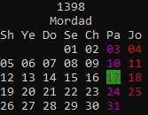

# pcal

A pure bash Persian (Jalaali) calendar converter and utility tool. No external dependencies required.

## Features

- **Bidirectional conversion** between Gregorian and Persian calendars
- **Pure bash implementation** - no external commands or dependencies
- **Calendar display** - view the current Persian month with highlighted current day
- **Flexible delimiters** - customize input and output date separators
- **Current date support** - quickly get today's Persian date
- **Accurate algorithm** - based on the proven [jalaali-js](https://github.com/jalaali/jalaali-js) implementation

## Installation

1. Clone or download the repository:
```bash
git clone https://github.com/esmaeelE/pcal.git
```

2. Make the script executable:
```bash
chmod +x pcal
```

3. (Optional) Add to your PATH:
```bash
# Add to ~/.bashrc or ~/.zshrc
export PATH="$PATH:/path/to/pcal"
```

Or copy to a directory already in your PATH:
```bash
sudo cp pcal /usr/local/bin/
```

## Usage

### Basic Date Conversion

Convert Gregorian to Persian date:
```bash
echo "2019-07-26" | pcal
# Output: 1398-05-04
```

Convert Persian to Gregorian date:
```bash
echo "1398-05-04" | pcal -g
# Output: 2019-07-26
```

### Get Current Persian Date

```bash
pcal -t
# Output: 1405-04-22 (example)
```

### Display Calendar

Show the current Persian month with a calendar view:
```bash
pcal -m
```

Output example:
```
        1405
      Tir
Sh Ye Do Se Ch Pa Jo
            01 02 03 
04 05 06 07 08 09 10 
11 12 13 14 15 16 17 
18 19 20 21 22 23 24 
25 26 27 28 29 30 31 
```

The current day is highlighted with a green background, and Fridays (Jo) are displayed in red.



### Custom Delimiters

Use a custom input delimiter (slash instead of dash):
```bash
echo "2019/07/26" | pcal -d /
# Output: 1398-05-04
```

Use a custom output delimiter:
```bash
echo "2019-07-26" | pcal -D /
# Output: 1398/05/04
```

Combine both:
```bash
echo "2019/07/26" | pcal -d / -D .
# Output: 1398.05.04
```

### Command Options

```
Usage: pcal [OPTIONS]

Options:
  -h          Display help message and exit
  -v          Display version and exit
  -d IDELIM   Use IDELIM instead of '-' for input date delimiter
  -D ODELIM   Use ODELIM instead of '-' for output date delimiter
  -g          Convert Persian calendar date to Gregorian calendar date
  -m          Display current Persian month in calendar format
  -t          Print current Persian date

Examples:
  echo "2019-07-26" | pcal               # Output: 1398-05-04
  echo "2019/07/26" | pcal -d /          # Custom input delimiter
  echo "2019-07-26" | pcal -D /          # Output: 1398/05/04
  echo "1398-05-04" | pcal -g            # Output: 2019-07-26
  pcal -t                                 # Show current date
  pcal -m                                 # Show calendar
  pcal -v                                 # Show version
```

## Date Format

### Input Format
- Gregorian: `YYYY-MM-DD` (e.g., 2019-07-26)
- Persian: `YYYY-MM-DD` (e.g., 1398-05-04)
- Custom delimiter can be specified with `-d` option

### Output Format
- Default: `YYYY-MM-DD`
- Custom delimiter can be specified with `-D` option

## Persian Calendar Information

The Persian calendar (also known as Jalaali calendar) is a solar calendar used in Iran and Afghanistan. Key features:

- **12 months**: Farvardin, Ordibehesht, Khordad, Tir, Mordad, Shahrivar, Mehr, Aban, Azar, Dey, Bahman, Esfand
- **First 6 months**: 31 days each
- **Months 7-11**: 30 days each
- **Month 12 (Esfand)**: 29 days (30 in leap years)
- **Leap years**: Follow a 33-year cycle with specific rules

## Algorithm

This tool implements the accurate Jalaali calendar conversion algorithm based on:
- Break points for leap year calculations covering years -61 to 3178
- Julian Day Number (JDN) as an intermediate representation
- Precise leap year determination using a 33-year cycle

## Supported Date Range

- **Persian years**: -60 to 3177
- **Gregorian years**: Approximately 561 CE to 3798 CE

## Testing

Run the integration test suite:
```bash
bash test_integration.sh
```

Or run the legacy jal_cal unit test:
```bash
bash test_jal_cal.sh
```

## Dependencies

None! This is a pure bash script with no external dependencies.

## Compatibility

- Requires bash 4.0 or higher (for associative arrays)
- Works on Linux, macOS, and Unix-like systems
- Tested on bash 4.x and 5.x

## Credits

Based on the algorithm from [jalaali-js](https://github.com/jalaali/jalaali-js) by the Jalaali community.

## License

This project is licensed under the GNU General Public License v3.0 - see the [LICENSE](LICENSE) file for details.

## Contributing

Contributions are welcome! Please feel free to submit issues or pull requests.

## Author

Persian Calendar Date Converter (pcal) - A bash implementation for accurate calendar conversion.

